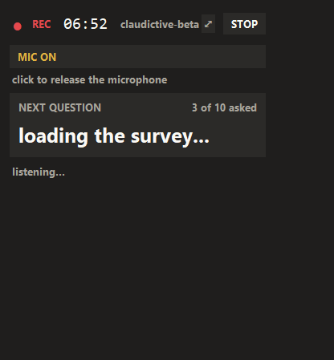
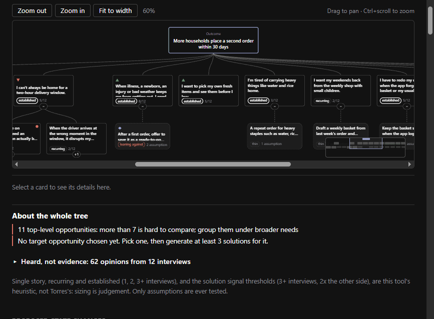
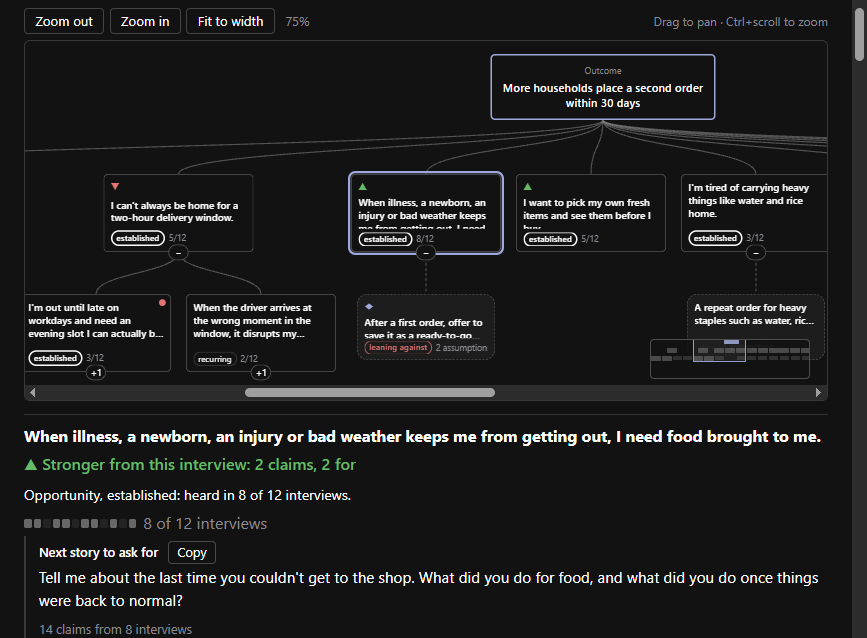

# Product Discovery Agent

Your discovery process, run by an agent: prep before each customer interview,
the right follow-up question during it, and synthesis into one opportunity
solution tree after it.

Free and open source (MIT). Windows. English and Hebrew.



## What it does

**Before the call.** `prep` lists what you still don't know: hypotheses no
interview has settled, the holes in your opportunity tree, guide questions you
never get to, and topics people keep raising that you never asked about. Each
one comes with a question to ask.

**During the call.** A small window sits on top of your video call. It shows
the next question in your guide and, when the interviewee says something worth
digging into, the follow-up to ask. A second pass drops any suggestion that
leads, pitches, or fishes for compliments (the Mom Test rules).

**After the call.** Each interview becomes short claims, each tied to the
moment it was said. Across interviews they build one opportunity solution tree
(Teresa Torres's method): your outcome at the top, the needs you heard under
it, the solutions under those. Code counts how many interviews back each node;
the model only proposes the structure.



The hub marks what each interview changed on the tree: ▲ stronger, ▼ weaker,
◆ mixed. Click a node for the claims behind it and the next story to ask for.



## Install

```
git clone https://github.com/Odiph/product-discovery-agent C:\src\pda
cd C:\src\pda
py -3 -m venv .venv
.venv\Scripts\python.exe -m pip install -r requirements.txt
```

## Use it

Run each command as `.venv\Scripts\python.exe -m app <command>`.

Try it first on mock data: `demo --yes` loads 12 invented interviews for
Shmuber Eats, a fictional grocery delivery app, already processed. It needs no
key and makes no API call. Then `missed --project shmuber-eats-demo --group model`
shows what the interviewer kept walking past, and `prep --project shmuber-eats-demo`
what to ask next time.

1. Copy `.env.example` to `.env` and add `SONIOX_API_KEY` (speech to text)
   and `ANTHROPIC_API_KEY` (the coach).
2. `author`: write the interview's brief, your question guide,
   and your hypotheses. A hypothesis can't be saved without what would prove
   it wrong.
3. `precheck`: confirm both sides of the call have sound.
4. Double-click `start-overlay.bat`, pick a project, and record.
5. Afterwards: `extract --all --yes` pulls the claims,
   `synthesize --yes` rebuilds the tree (run it without `--yes` first to see the cost),
   and `hub` opens the review page.

Already have recordings or transcripts? `import <file-or-folder>`; for a
transcript, add `--me <your speaker name>`.

## From Claude Code

The `discovery` plugin lets Claude Code, in your product's own repository,
answer questions from the interviews with citations, draft hypotheses and
interview questions, and rebuild the tree.

```
setx DISCOVERY_COPILOT_HOME "C:\src\pda"
claude plugin marketplace add "C:\src\pda\integrations\claude-code"
claude plugin install discovery@discovery-copilot-local
```

Restart Claude Code, then run `/discovery:link-discovery <project>` in your
product repository. After that: `/discovery:evidence <question>`,
`/discovery:interview-gap`, `/discovery:synthesize`.

## Privacy

You are recording other people. Get their consent before you start. Call audio
goes to Soniox for transcription; transcript text goes to Anthropic, or to a
model you host yourself. Everything else stays in this folder on your machine.
The full list of what is sent where is in the
[guide](docs/GUIDE.md#privacy-consent-and-data-flows).

## Not ready to install?

[Version 0](docs/version-0.md) is the same process as one prompt and a
checklist.

## More

- [The full guide](docs/GUIDE.md): every command, setup, importing recordings,
  troubleshooting.
- Every command has `--help`.
- [Security](SECURITY.md) · [License: MIT](LICENSE)
